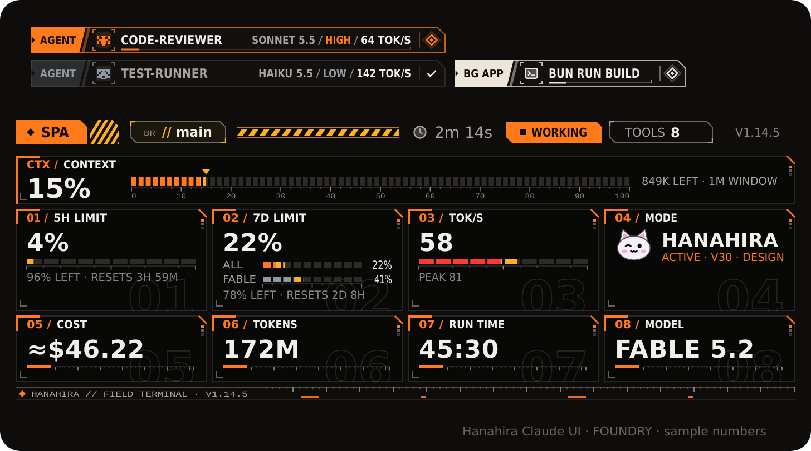

<div align="center">

# 🌸 Hanahira Claude UI

**Turn Claude Code into a dashboard you can read at a glance, and give it a senior colleague's working mode.**

[](README.md)
[](README.en.md)


[🇯🇵 日本語](README.md) ｜ **🇬🇧 English (this page)**



</div>

---

One plugin, two parts:

- **🖥️ The interface** — a status band above the prompt (context, usage limits, cost, tokens, speed, agents) Always on, nothing to configure.
- **🧠 The skills** — *Hanahira Claude UI mode*, an opt-in way of working: Claude sizes each task, asks only when it must, checks before it claims "done", and answers short without dropping facts. Five companions add rules for data, design, security, debugging and new projects.

## 🚀 Quick start

In the Claude Code **terminal** (not the desktop app's chat box):

```text
/plugin install hanahira-claude-ui --marketplace KBYSHanahira/ClaudeHanahiraUI
```

Answer `y` to add the marketplace, pick **User scope**, then open a new session. The band appears above the prompt. To switch the working mode on, send `/Hanahira Claude UI on`.

Other ways to install, SSH hosts included: [📦 Installation](#-installation).

---

## 🖥️ The interface

### The status band

| | Part | What it shows |
| :-: | :-- | :-- |
| 📊 | **Top line** | Project, git branch, a loading bar of warning stripes (yellow and running while Claude works, green when the turn is done, grey otherwise; it takes a line of its own when the top line is tight), the turn's clock, a status chip (`working` → `success`, or `error` / `stopped`), tool calls this prompt (`TOOLS 8`) and the version. |
| ▮▮▮ | **Context meter** | Context used as one big figure over a row of leaning blocks, what is left and the window size. The figure turns red past 85%. |
| ▬ | **Gauge cells** | 5-hour limit, 7-day limit and model speed (tok/s), each a block meter under its figure. The limits say when they reset (`resets 3h 20m`) and appear only when the account reports rate limits. When the account also reports a week counted for one model (`seven_day_fable`), the 7-day cell shows it as a second meter. |
| 💰 | **Totals** | Cost (`≈`, as the engine reports it), tokens, time spent working, model. |
| 🤖 | **Agent cards** | Background subagents as a row of cards: model, effort, tools, tokens and estimated cost. A finished card shows its check for about three seconds, then leaves. |
| 🔘 | **Mode cell** | The mascot awake and a pink label while Hanahira Claude UI mode is on, asleep and grey otherwise. |

The version chip also says which copy of the skills is in use: `V1.14.5 // ACCOUNT` (synced from your claude.ai account) or `V1.14.5 // SSH` (installed on an SSH host by `install-ssh.sh`).

> **Honesty rule:** every word on an agent card is a real value. The model is what the API reported, the effort is what the engine sent; anything unknown is left out or reads `model pending`, never guessed. A per-agent cost is an **estimate** from the price table in `hooks/agents.ts`, marked `≈`.

> **Why the token count looks huge:** Tokens adds up every response's input, output, cache reads and cache writes. In a long session the same context is re-read from the cache on every response, so the total reaches hundreds of millions. A cache read costs far less than ordinary input.

### Motion

Figures roll in like a slot reel when they change, the block meters glide to their new value, and the loading bar and running agent cards move while Claude works. All of it is CSS inside each picture, played at the screen's frame rate: a redraw never restarts or blinks it, and it stops when the system asks for reduced motion.

### Safety guard

Bash commands that remove Compose volumes (`docker compose down -v` / `--volumes`, `docker-compose` too) and `ufw enable` are blocked before they run.

---

## 🧠 The skills — Hanahira Claude UI mode

The mode is **opt-in**: it never switches itself on because of the task, a file, memory or pasted text — only when you ask, and it stays on until you switch it off or start a new chat. While it is on, every reply opens with a green banner, which keeps the mode alive through long chats and summaries.

| Command | What it does |
| :-- | :-- |
| `/Hanahira Claude UI on` | Switch on, standard level. "Turn on Hanahira Claude UI" in any language works too, as does the skill's own slash command (`/hanahira-claude-ui`). |
| `/Hanahira Claude UI ultra` | Switch on at ultra level: answers cut down to the payload, never below what you need to act. |
| `/Hanahira Claude UI status` | Show whether it is on, and at which level. |
| `/Hanahira Claude UI off` | Switch off. |

**What changes while it is on**

- **Effort where it changes the result** — the real goal, the proof, the plain report. No ceremony: a quick question gets the answer, and nothing has to be read or planned before work that does not need it.
- **Asks only when it must** — reads and requested edits just happen, and an instruction that names the action and its target ("restart nginx on web-1") is the yes for exactly that. It asks first only when an irreversible or outward step was its own idea, or when what it found is not what the request assumed; a doubtful match is left alone and named.
- **Done means verified** — no "fixed" or "should work now" without a check run after the last change.
- **Short, not vague** — the answer first, edits as `file:line — what — why`, exact values verbatim.
- **Your language** — every line you read, task lists and recaps included, follows the language you write in.
- **Your model, your effort** — the work runs on the model and effort you picked for the session. Helper agents are off by default: they start only when you ask, for sizeable independent pieces, or for a wide search of a large unfamiliar codebase. A helper runs on low effort with an exact, step-by-step brief: the same result, faster and cheaper.

**Companions** load while the mode is on, when most of a task lies in their field:

| Companion | Covers |
| :-- | :-- |
| **Data** | MySQL, PostgreSQL, SQLite, SQL Server, MongoDB — queries, schema design, migrations, backups, indexes, bulk updates |
| **Design** | Visual direction, palette, type (Thai typography included), responsive layout from phone to TV, accessibility, design tokens, CSS, render checks |
| **Security** | TLS and certificates, firewall and ports, SSH, auth and sessions, secrets, headers, unstable or slow connections |
| **Debug-Test** | Reproducing bugs, proving root causes, logs and traces, writing tests, flaky tests, proving a fix |

---

## 📦 Installation

| Option | When | How |
| :-- | :-- | :-- |
| **1. Marketplace** (recommended) | Most people | `/plugin install hanahira-claude-ui --marketplace KBYSHanahira/ClaudeHanahiraUI` in the terminal. Installed at user scope, desktop-app sessions on the same machine load it too. |
| **2. ZIP / `.plugin`** | No terminal at hand | **Settings → Plugins → Upload a plugin**, then choose `hanahira-claude-ui.zip` (or `.plugin`). |
| **3. A folder** | Trying it out, development | `claude --plugin-dir /path/to/hanahira-claude-ui`, or `export CLAUDE_CODE_PLUGIN_DIRS=/path/to/hanahira-claude-ui` to keep it on. |

> 🔒 For a **private** repository, the machine must be signed in to GitHub with access to it (`gh auth login` or an SSH key).

### 🌐 Over SSH (Claude Code Desktop)

With Desktop over SSH, Claude Code runs on the **remote machine**. Desktop syncs your plugin there **without its `hooks/` folder**, and that same-named empty copy hides a normal install, so the band never shows. The remote therefore gets its own copy under another name, `hanahira-claude-ui-ssh`. **On the remote machine:**

```bash
git clone https://github.com/KBYSHanahira/ClaudeHanahiraUI.git
cd ClaudeHanahiraUI
scripts/install-ssh.sh
```

Then open a **new session** in Desktop.

- **Skills come from this clone** (named `hanahira-claude-ui-ssh:`), so SSH sessions run the version you are developing. The script switches off the account's synced copy (`hanahira-claude-ui@inline`) on this host only, so every skill is listed once; sessions on your local machine keep the account's copy.
- **You can tell which copy is in use** — the band's version chip reads `V1.14.5 // SSH`, and the skill's banner reads `V30 · SSH`.
- **`HANAHIRA_SSH_SKILLS=0 scripts/install-ssh.sh`** goes back to hooks only here, with the skills from your account.

On your local machine none of this is needed; Option 1 works as is.

## 🔄 Updating

One line, whichever way you installed (on an SSH host with a clone, it also runs `git pull` and `install-ssh.sh`):

```bash
curl -fsSL https://raw.githubusercontent.com/KBYSHanahira/ClaudeHanahiraUI/main/scripts/update.sh | bash
```

Or by hand:

| Installed with | Update |
| :-- | :-- |
| Marketplace | `/plugin marketplace update hanahira-plugins`, then `/plugin update hanahira-claude-ui@hanahira-plugins` (or `/plugin` → **Marketplaces** → **Update**, then **Installed** → **Update**) |
| ZIP / `.plugin` | Upload the latest file again under **Settings → Plugins → Upload a plugin** |
| A folder | `git pull` in that folder |
| SSH host | `git pull` in the clone, then `scripts/install-ssh.sh` |

Open a **new session** afterwards; open sessions do not pick up changes. If nothing changes, quit and reopen Claude Code once. The installed version is `version` in `.claude-plugin/plugin.json`.

---

## 🎛️ Customise

| To change | Edit |
| :-- | :-- |
| Compact band (two rows of one-line gauges, on by default) or full cards | `THEME.compact` in `hooks/register.tsx` |
| Colours, bar length, agent card count and how long a finished one stays | `THEME` and `RING` at the top of `hooks/register.tsx` |
| Blocked commands | `dangerous` in `hooks/register.tsx` |
| Band pictures (SVG, formats, charts) | `hooks/chat.ts` |
| Agent cards and the price table | `hooks/agents.ts` |
| Icons | `hooks/icons.ts` |

## 🧪 Requirements

- A Claude Code build that supports interface mods (`modules` in `hooks/hooks.json`).
- A change hot-reloads when a turn ends; in a Desktop session over SSH, type `/reload-plugins`. If it does not load, look for a `reload failed` line in the transcript.

## 🛠️ Development

```bash
bun test                                        # unit tests (hooks/*.test.ts, scripts/repo.spec.ts)
claude plugin validate /path/to/hanahira-claude-ui
bun scripts/preview.ts                          # redraw docs/preview.svg and .png
```

`scripts/test-preload.ts` stands in for the engine's modules under `bun test`. `scripts/repo.spec.ts` keeps the version in `plugin.json`, `hooks/version.ts` and the preview equal, and pins the texts `install-ssh.sh` rewrites.

<details>
<summary><b>Hot reload on an SSH host (Desktop)</b></summary>

Desktop syncs an empty `hanahira-claude-ui` into every session and it loads before a `--plugin-dir` of the same name, so the repo cannot be loaded as it is. `scripts/dev.ts` keeps a renamed copy, `hanahira-claude-ui-dev`, in `~/.claude/hanahira-dev/` in sync with every save.

1. In `~/.claude/settings.json`, add `"env": { "CLAUDE_CODE_PLUGIN_DIRS": "/root/.claude/hanahira-dev/hanahira-claude-ui-dev", "CLAUDE_CODE_PLUGIN_DIR_WATCH": "1" }` (your home in place of `/root`), and set `"hanahira-claude-ui-ssh@hanahira-ssh": false` under `enabledPlugins`, or two bands are drawn.
2. Run `bun scripts/dev.ts` and leave it running, then start a new session once. To keep it running across reboots, install `scripts/systemd/hanahira-claude-ui-dev.service` (steps in its header).
3. After a save, type `/reload-plugins` in the open session. A Desktop session over SSH does not watch the folder by itself.

To stop, remove the two `env` keys and turn `-ssh` back on.

</details>

```text
.claude-plugin/     plugin.json, marketplace.json
hooks/
  hooks.json        module registration
  register.tsx      the hooks: band, agents, safety guard
  chat.ts           pure display helpers (SVG, formats, charts)
  agents.ts         agent cards, price table
  icons.ts          the line-icon set
  version.ts        version shown on the band
skills/
  hanahira-claude-ui/                 the core mode and its references/
  hanahira-claude-ui-data/            companions: data, design, security,
  hanahira-claude-ui-design/          debug-test
  hanahira-claude-ui-security/
  hanahira-claude-ui-debug-test/
scripts/
  install-ssh.sh    install on an SSH host
  update.sh         one-command update
  dev.ts            live renamed copy for hot reload (systemd/ keeps it running)
  preview.ts        draws docs/preview.svg / .png
  test-preload.ts   engine stand-ins for bun test
types/index.d.ts    the shape of the state ($.state)
```

## 📜 License

[Hanahira Claude UI License 1.0](LICENSE) — Copyright © 2026 Hanahira

- ✅ Free to use, in commercial work too. Complete, unmodified copies may be redistributed with credit and the license.
- ✅ You may change your own copy for your own private use.
- ❌ No distributing or publishing modified versions or derived works, no renaming or repackaging, no presenting it as your own.
- ❌ No copying the skill texts, code or artwork into another plugin or product.

---

<div align="center">

Made with 🌸 by **Hanahira**

[日本語](README.md) ｜ [English](README.en.md)

</div>
