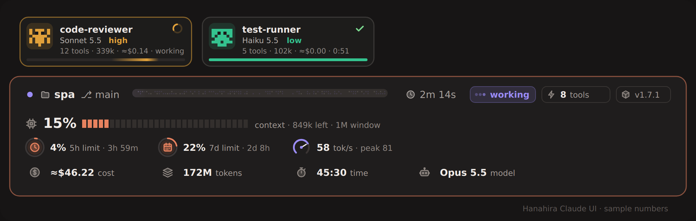
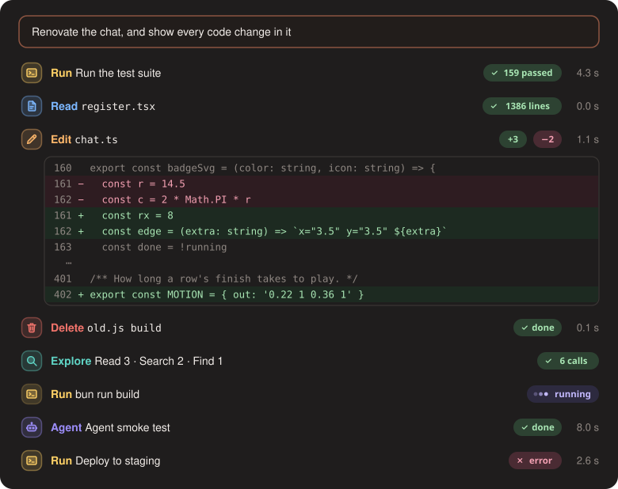

<div align="center">

# 🌸 Hanahira Claude UI

**Claude Code を、ひと目でわかるダッシュボードに。**

プロンプト上のステータスバンド・リング型ゲージ・エージェントカードを追加する、Claude Code 用インターフェース Mod です。

[](README.md)
[](README.en.md)


**🇯🇵 日本語（このページ）** ｜ [🇬🇧 English](README.en.md)

</div>

---

## ✨ 主な機能

| | 機能 | 内容 |
| :-: | :-- | :-- |
| 📊 | **ステータスバンド** | プロンプトの上に、プロジェクト名・git ブランチ・作業中を示すローディングバー・経過時間・状態・ツール呼び出し数（`⚡ 8 tools`）を表示します。 |
| ▮▮▮ | **コンテキストメーター** | コンテキスト使用率を大きな数字と30ブロックのメーターで表示する、バンドで唯一大きく描かれる要素。残り量とウィンドウサイズが続きます。85% を超えると赤くなります。 |
| ⭕ | **リングゲージ** | 5時間制限、7日制限、モデル速度を小さなリングで表示。制限にはリセットまでの時間（例：`resets in 3h 20m`）も出ます。 |
| 💰 | **合計カード** | 費用（Cost）・トークン（Tokens）・稼働時間（Time）をカードで表示。Time は終わったターンの合計で、進行中の時間は上の行の時計に出ます。 |
| 🤖 | **エージェントカード** | バックグラウンドのサブエージェントを横並びのカードで表示。完了したカードは約 3 秒でチェックを見せて消えます。 |
| 🧾 | **会話ログの装飾** | 自分のメッセージはバンドと同じ枠のカード。ツール呼び出し・まとめられた実行・バックグラウンドタスクの行はすべて同じ形です：種類タイル、色付き動詞、対象（ファイルは等幅）、ステータスピル、所要時間。`rm` によるファイル削除は赤い **Delete** 行になります。 |
| ✏️ | **コード変更をその場で表示** | Edit・Write は変更内容を行のすぐ下に表示します：行番号つき、追加行は緑、削除行は赤の背景、パッチが飛ばした所は `⋯`。ピルは `saved` の代わりに `+N` / `−N`。全体表示（ctrl+o）ではエンジン本来の表示のままです。 |
| 🎞️ | **動きなし** | すべて静止画です：実行中のピルは 3 つの点、終わったピルはチェックか ×。何も変わらない再描画は同じ画像なので、点滅しません。 |
| 🛡️ | **安全ガード** | Compose のボリュームを削除する Bash コマンド（`docker compose down -v` / `--volumes`、`docker-compose` も）と `ufw enable` をブロックします。 |

> **正直さの原則：** エージェントカードの表示はすべて実際の値です。モデル名は API が返したもの、effort はエンジンが送った値だけを表示し、不明なものは推測せず省略するか `model pending` と表示します。エージェントごとの費用は価格表（`hooks/agents.ts`）からの **概算** で、`≈` を付けています。

### 画面イメージ

<div align="center">



*プラグイン自身の SVG 描画関数で作った画像です（数値はサンプル）。再生成: `bun scripts/preview.ts`*



*会話ログの行も同じ方法で描いています。再生成: `bun scripts/preview-chat.ts`*

</div>

#### 画面イメージ（概念図）

```text
┌─ spa  ⎇ main  ▰▰▰▰▰▰▰▱▱▱▱▱▱▱▱▱▱▱▱▱▱▱  45:30  ● working   ⚡ 8 tools ─┐
│  ◔ 15%            ◔ 4%                ◔ 22%                                    │
│  context 151k/1M  of 5-hour limit     of 7-day limit                           │
│                   resets in 3h 59m    resets in 2d 8h                          │
│  [ Cost ≈$46.22 ] [ Tokens 172M ] [ Time 45:30 ]                              │
└────────────────────────────────────────────────────────────────────────────────┘
```

---

## 📦 インストール

### 方法 1：マーケットプレイスから（推奨）

Claude Code の **ターミナル** で次を入力します（デスクトップアプリのチャット欄ではありません）。

```text
/plugin install hanahira-claude-ui --marketplace KBYSHanahira/ClaudeHanahiraUI
```

1. マーケットプレイスを追加するか聞かれたら `y` と答えます。
2. スコープを選びます。**user スコープ**にすると、すべてのセッションで有効になります。
3. 同じマシンで user スコープに入れておくと、デスクトップアプリから始めたセッションでも読み込まれます。

> 🔒 リポジトリが **private** の場合は、インストールするマシンが GitHub にログイン済みで、このリポジトリへのアクセス権が必要です（`gh auth login` または SSH キー）。

### 方法 2：ZIP / `.plugin` ファイルをアップロード

**設定 → Plugins → Upload a plugin** から `hanahira-claude-ui.zip`（または `.plugin`）を選びます。

### 方法 3：フォルダを直接指定（開発・試用向け）

```bash
claude --plugin-dir /path/to/hanahira-claude-ui
```

**SSH ホスト（Desktop）でのホットリロード。** Desktop はすべてのセッションに空の `hanahira-claude-ui` を同期し、それが同名の `--plugin-dir` より先に読み込まれるため、リポジトリをそのままでは読み込めません。`scripts/dev.ts` は名前を変えたコピー `hanahira-claude-ui-dev` を `~/.claude/hanahira-dev/` に置き、保存のたびに同期します。

1. `~/.claude/settings.json` に `"env": { "CLAUDE_CODE_PLUGIN_DIRS": "/root/.claude/hanahira-dev/hanahira-claude-ui-dev", "CLAUDE_CODE_PLUGIN_DIR_WATCH": "1" }` を追加し（`/root` は自分のホームに）、`enabledPlugins` の `"hanahira-claude-ui-ssh@hanahira-ssh"` を `false` にします。そうしないとバンドが 2 つ表示されます。
2. `bun scripts/dev.ts` を起動したままにし、新しいセッションを一度開きます。
3. 保存するたびに、開いているセッションでモッドが再読み込みされます（Claude による編集はそのターンの終わりに）。やめるときは `env` の 2 つのキーを消し、`-ssh` を有効に戻します。

環境変数で常時有効にすることもできます。

```bash
export CLAUDE_CODE_PLUGIN_DIRS=/path/to/hanahira-claude-ui
```

### 🌐 SSH 接続先で使う場合

Claude Code Desktop で SSH 接続先を使う場合、Claude Code 本体は **接続先のマシン** で動きます。Desktop は手元のプラグインを接続先へ同期しますが、**`hooks/` フォルダは同期されません**。しかも同期された（中身のない）同名のコピーが、接続先にインストールした本物を上書きしてしまうため、普通に入れても何も表示されません。

そこで、接続先には **別名（`hanahira-claude-ui-ssh`）のコピー** を入れます。**接続先のマシンで**、このリポジトリをクローンして次を実行してください:

```bash
git clone https://github.com/KBYSHanahira/ClaudeHanahiraUI.git
cd ClaudeHanahiraUI
scripts/install-ssh.sh
```

その後、Desktop で **新しいセッション** を開きます（開いているセッションには反映されません）。`git pull` で更新したら、もう一度 `scripts/install-ssh.sh` を実行してください。手元のマシン（ローカル）で使う場合はこの手順は不要で、方法 1 のままで動きます。

## 🔄 アップデート

新しいバージョンが出たら、**インストールした方法に合わせて** 更新します。更新後は **新しいセッション** を開いてください（開いているセッションには反映されません）。

### 🧰 一発で更新（`update.sh`）

コマンドを覚えなくても、次の 1 行でマーケットプレイス版を更新できます（SSH 接続先でクローン済みなら、`scripts/update.sh` が `git pull` と `install-ssh.sh` まで行います）。

```bash
curl -fsSL https://raw.githubusercontent.com/KBYSHanahira/ClaudeHanahiraUI/main/scripts/update.sh | bash
```

### マーケットプレイスから入れた場合（方法 1）

Claude Code の **ターミナル** で、次の 2 つを順に入力します。

```text
/plugin marketplace update hanahira-plugins
/plugin update hanahira-claude-ui@hanahira-plugins
```

または、`/plugin` を開いて **Marketplaces** → `hanahira-plugins` → **Update**、続けて **Installed** → `hanahira-claude-ui` → **Update** でも更新できます。

### ZIP / `.plugin` で入れた場合（方法 2）

最新の ZIP を入手し、もう一度 **設定 → Plugins → Upload a plugin** からアップロードします（上書きされます）。

### フォルダを指定している場合（方法 3）

そのフォルダで `git pull` するだけです。

```bash
cd /path/to/hanahira-claude-ui
git pull
```

### SSH 接続先の場合

**接続先のマシンで**、クローンしたフォルダを更新して、インストールスクリプトをもう一度実行します。

```bash
cd ClaudeHanahiraUI
git pull
scripts/install-ssh.sh
```

> 💡 バージョンは `.claude-plugin/plugin.json` の `version` で確認できます。更新したのに変わらないときは、Claude Code を一度終了して開き直してください。

---

## 🚀 使い方

インストール後は **設定不要** です。Claude Code を開くと、プロンプトの上にバンドが現れます。

| 表示 | 見方 |
| :-- | :-- |
| **ローディングバー** | Claude が作業している間は光が流れ、待機中は静かなラインになります。 |
| **`⚡ N tools`** | このプロンプトで呼ばれたツールの数。増えた瞬間にフラッシュします。 |
| **コンテキストメーター** | 現在のコンテキストの使用率、残り量、ウィンドウ（例：`11% ▮▮▮▯▯ context · 889k left · 1M window`）。 |
| **5時間 / 7日のリング** | 利用制限の消費率と、リセットまでの残り時間。アカウントが制限情報を返す場合のみ表示されます。 |
| **Cost** | エンジンが報告するセッション合計費用（`≈` つき）。 |
| **Tokens** | プラグインの読み込み後に数えた合計トークン。サブエージェント分を含み、キャッシュの読み書きも含みます。 |
| **Time** | 作業に費やした合計時間。 |
| **エージェントカード** | バンドの枠の上に横並び。実行中は枠が脈打ち、完了すると緑に光って消えます。 |


> **トークン数が大きく見える理由：** Tokens は、モデルの応答ごとの入力・出力・キャッシュ読み込み・キャッシュ書き込みをすべて足した累計です。コンテキストが大きい長いセッションでは、同じ文脈が毎回キャッシュから読み直されるため、数億の値になります。キャッシュ読み込みは通常の入力よりずっと安価です。

---

## 🎛️ カスタマイズ

- `hooks/register.tsx` の `THEME.compact`（既定でオン）は、統計を 1 行ずつのゲージと数値の 2 段（列がそろう）で描き、高さをおよそ半分にします。`false` で従来のカードに戻ります。
- 色・アイコン・リングの大きさ・バーの長さ・カード表示数・完了カードの表示時間は、`hooks/register.tsx` 冒頭の `THEME` と `RING` で変更できます。
- ツール行の見た目は `hooks/chat.ts`、エージェントカードと価格表は `hooks/agents.ts`、アイコンは `hooks/icons.ts` です。
- ブロックするコマンドは `hooks/register.tsx` の `DANGEROUS` で編集できます。
- 制限リングは、アカウントがレート制限を報告する場合だけ表示されます。

## 🧪 動作要件と注意

- 公式の Mod 機構（`hooks/hooks.json` の `modules`）を使うインターフェース Mod です。対応する Claude Code のビルドが必要です。
- 変更はターン終了時にホットリロードされます。反映されないときは、会話ログの `reload failed` の行を確認してください。

## 🛠️ 開発

```bash
claude plugin validate /path/to/hanahira-claude-ui
claude --plugin-dir /path/to/hanahira-claude-ui
```

純粋関数は `hooks/chat.ts` などにまとめ、テスト（`hooks/*.test.ts`）があります。`bun test` で実行できます（`scripts/test-preload.ts` がエンジンのモジュールの代わりを務めます。`claude plugin test` のある CLI ではそちらでも）。構成：

```text
.claude-plugin/   plugin.json / marketplace.json
hooks/
  hooks.json      モジュールの登録
  register.tsx    フック本体（バンド・ログ・エージェント）
  chat.ts         表示用の純粋関数（SVG・書式・チャート）
  agents.ts       エージェントカード・価格表
  icons.ts        線アイコン一式
scripts/
  test-preload.ts bun test 用のエンジン代替モジュール
  preview.ts      docs/preview.svg を描く
  preview-chat.ts docs/preview-chat.svg を描く
  dev.ts          ホットリロード用の名前を変えたコピー
types/index.d.ts  状態（$.state）の型
```

---

<div align="center">

Made with 🌸 by **Hanahira**

[日本語](README.md) ｜ [English](README.en.md)

</div>
